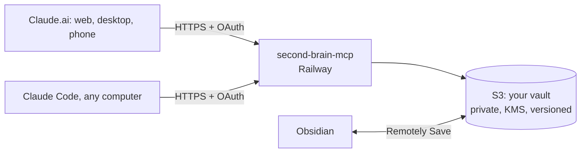

# second-brain-mcp

**One shared, people-first second brain for every Claude you use.**

An open-source [MCP](https://modelcontextprotocol.io) server that turns an Obsidian vault into memory shared across Claude.ai (web, desktop, mobile), Claude Code on any computer, and Claude Desktop. Notes stay plain Markdown, so you can still read and edit them in Obsidian.



## Why
- **People first.** People, organizations, meetings, and how people connect to each other are built in. Connections are written on both people's notes. Every conversation is logged on each attendee, with `last_contact` and follow-ups tracked.
- **One brain, everywhere.** Every Claude session reads from and writes to the same vault, so context carries across chats, devices and `/compact`.
- **Your data stays yours.** Plain `.md` files in your own S3 bucket. No hard deletes; every version is kept.
- **Secure by default.** HTTP mode won't start without OAuth, and only allowlisted, verified Google accounts get in. See [SECURITY.md](SECURITY.md).

## Tools

| Notes | | People | |
|---|---|---|---|
| `context` | session start: rules, Home, relevant notes, follow-ups | `person` | full profile, connections, log, meetings, mentions |
| `search` | keywords over names, frontmatter and content | `upsert_person` | create/update; matches aliases to avoid duplicates |
| `read` | one or more notes | `log_interaction` | Meeting note + each attendee's Log + Daily |
| `capture` | quick note to the Inbox | `connect` | relationship, written both ways (`reports_to` ↔ `manages`, …) |
| `write` / `patch` | create / targeted edit | `who_knows` | people at an org; connection path to someone |
| `link` | link two notes both ways | `follow_ups_due` | overdue and upcoming follow-ups |
| `daily` | append to today's note | `people_graph` | nodes + edges, filter by org/context |
| `archive` | the only "delete": moves to `Archive/` | | |
| `health` | broken links, orphans, inbox, stale projects | `activity` | what occupied your time: trends in topics, notes, people, projects |

### Activity stats
With a Postgres database configured, the server records one small event per tool call: which notes were touched, and the tags, projects, people and organizations in their frontmatter. Never note contents. Ask Claude for a retrospective ("what took my time this quarter?") and it calls `activity`, which returns aggregates only: a weekly or monthly time series, top topics/notes/people/projects with the trend against the previous period, new notes, interactions by person, and what went quiet. Each bucket also splits its score across the period's top topics (`by_topic`), ready for a stacked "where my attention went" chart.

The **`retrospective`** prompt turns that into a one-click visual report: KPI cards, the stacked timeline, top topics/projects/people/notes with trends, what went quiet, 3–5 insights and reflection questions, and an offer to save a summary to `Reviews/` in the vault. In Claude.ai it shows up in the prompt menu; in Claude Code it's `/mcp__second-brain__retrospective 90d`.

Repeated reads of the same note within 30 minutes count once, and routine calls (`context`, `health`, `follow_ups_due`) aren't recorded. On by default when a database is configured; `SB_STATS=off` turns it off. See [SECURITY.md](SECURITY.md#activity-stats) for what's stored.

## Vault format
PARA folders plus `People/`, `Organizations/`, `Meetings/`, `Daily/` and `00-Inbox/`. YAML frontmatter on every note, and `[[wikilinks]]` by bare name. See [`examples/vault`](examples/vault) (all fictional): copy it to start your own vault, and edit its `CLAUDE.md` to change the rules Claude follows.

## Quick start (local)
```bash
git clone https://github.com/liorsolomon/second-brain-mcp && cd second-brain-mcp
uv sync
claude mcp add second-brain -e SB_VAULT_PATH="$PWD/examples/vault" -- uv --directory "$PWD" run second-brain-mcp
```

## Deploy to the cloud
1. [AWS setup](docs/aws-setup.md): Terraform for the bucket, KMS key, least-privilege IAM user and CloudTrail
2. [Deploy to Railway and connect Claude](docs/deploy-and-connect.md)
3. [Sync Obsidian with the S3 vault](docs/obsidian-sync.md) (Remotely Save, desktop and mobile)
4. [Make every Claude use it](docs/always-on.md): read the vault at the start of every chat and log new topics as they come up, on every device

## Roadmap
- [x] Activity stats: what occupies your time, as aggregates Claude can chart
- [ ] Semantic search: heading-level chunks, pgvector + full-text, merged by rank, with frontmatter filters
- [ ] `/brain` skill and MCP prompts for the session routine, weekly review and retrospectives (see [always-on.md](docs/always-on.md#5-optional-a-skill-for-the-playbook))
- [ ] Persistent OAuth client storage (survives restarts)
- [ ] Optional field-level encryption for contact details

## Development
```bash
uv sync
uvx pre-commit install
uv run ruff check . && uv run pyright && uv run pytest -q
```

Inspired by [Vasallo94/obsidian-mcp-server](https://github.com/Vasallo94/obsidian-mcp-server), [sweir1/obsidian-brain](https://github.com/sweir1/obsidian-brain), [neverprepared/mcp-obsidian-second-brain](https://github.com/neverprepared/mcp-obsidian-second-brain) and [hess0ul/second-brain](https://github.com/hess0ul/second-brain).

[MIT](LICENSE)
