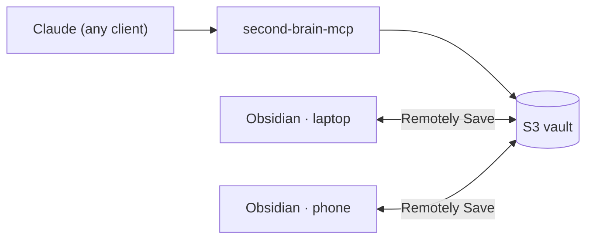

# Sync Obsidian with the S3 vault

Obsidian has no built-in S3 support. The community plugin **Remotely Save** syncs a local vault with an S3 bucket on desktop and mobile. The server and Obsidian then share the same bucket: notes Claude writes appear in Obsidian after the next sync, and your edits reach Claude the same way.



## 1. Create the Obsidian identity (Terraform)
`obsidian_sync = true` is the default. It creates:
- the IAM user **`second-brain-obsidian`**, which can list the bucket and read, write and delete notes (a delete only leaves a delete marker), and use the vault's KMS key;
- an entry for that user in the bucket policy's allow list. Like everyone except your admins, it **can't delete object versions**, so history is always recoverable;
- a CORS rule for Obsidian's app origins (`app://obsidian.md`, `capacitor://localhost`, `http://localhost`). CORS doesn't grant access: every request must still be signed by an allowed IAM user.

```bash
cd infra/terraform && terraform apply
aws iam create-access-key --user-name second-brain-obsidian
```
This key lives on your devices. **Don't reuse the server's key**, so you can revoke either one without affecting the other.

## 2. Configure Remotely Save
In Obsidian, go to Settings → Community plugins → Browse, install **Remotely Save** and enable it. Then in its settings:

| Setting | Value |
|---|---|
| Remote service | S3 or S3-compatible |
| Endpoint | `s3.<region>.amazonaws.com` |
| Region | your bucket's region |
| Access Key ID / Secret | the `second-brain-obsidian` key from step 1 |
| Bucket name | your vault bucket |
| Remote prefix | the same as `SB_S3_PREFIX` (usually empty) |
| **Encryption password** | **leave empty**: the server must be able to read notes. The bucket's KMS encryption protects them at rest. |
| Sync config dir (`.obsidian`) | **off**: plugin settings, including this access key, stay on the device |
| Schedule | every 5 minutes, and on startup |
| Conflict handling | keep the newer version (S3 versioning keeps the other) |

Run **Check connectivity**, then the first sync.

### First sync
If the bucket already holds your vault (uploaded with `aws s3 sync`, see `aws-setup.md`), start from an **empty** local vault on each device and let it download. Two full copies syncing for the first time produce a lot of conflicts.

## 3. Phones
Install Obsidian and Remotely Save on the phone and use the same settings. Mobile apps need the CORS rule from step 1.

## Security notes
- The plugin stores the access key in the vault's `.obsidian/` folder on each device. Use full-disk encryption and a device passcode.
- **If a device is lost:** delete its key (`aws iam delete-access-key --user-name second-brain-obsidian --access-key-id …`) and create a new one for your other devices. The server isn't affected.
- Deletes from Obsidian are recoverable: they add a delete marker, and earlier versions stay until an admin removes them.
- CloudTrail logs this user's activity separately from the server's, so access from an unknown IP stands out.

## Conflicts
Remotely Save syncs on a schedule, so a note edited in Obsidian and through Claude between two syncs is a conflict. The plugin keeps one version by the rule you chose, and S3 keeps the other as an older version. To restore it, list the note's versions with `aws s3api list-object-versions --bucket <bucket> --prefix "<path>.md"`, then `get-object --version-id`.
